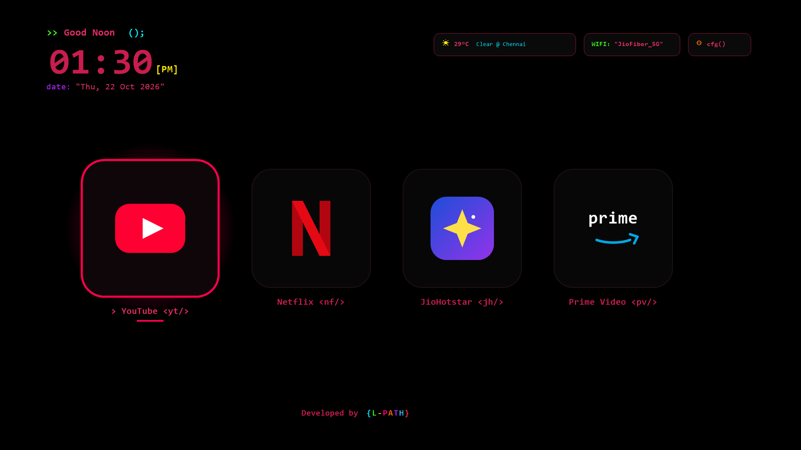

# Minimal TCL / Android TV Launcher (`com.example.minimaltv`)

A distraction-free, ultra-fast Kotlin Jetpack Compose Android TV Launcher designed for TCL, Google TV, and Android TV devices (`minSdk 26`, `targetSdk 34`).

## Highlights

- **Pitch-Black OLED/LED Backdrop (`#000000`)**: Zero ambient light pollution in dark living rooms.
- **Dynamic Time-of-Day Greeting**: Automatically greets with `>> Good Morning ();`, `>> Good Noon ();`, or `>> Good Evening ();` based on local hour.
- **Wine Red & Multicolor Coding Typography**: High-contrast monospace coding aesthetic with syntax-highlighted accents.
- **Pulsing Neon Glow on Remote Focus**: Focused D-Pad cards radiate a soft multi-layered neon aura with a glowing accent border.
- **Remote Navigation Audio**: Audio feedback for D-Pad navigation and app launching.
- **Live Status Header**:
  - Big monospace clock (`hh:mm [AM/PM]`) & formatted date.
  - Live weather (`°C`, condition, auto-located city via Open-Meteo).
  - Connected Wi-Fi SSID name (or Ethernet status).
  - Focusable TV settings shortcut (`cfg()`).
- **4 D-Pad Focusable Streaming Cards**:
  1. **YouTube** (`com.google.android.youtube.tv`)
  2. **Netflix** (`com.netflix.ninja`)
  3. **JioHotstar** (`in.startv.hotstar` with fallback `in.startv.hotstar.dplus.tv` / `com.jio.media.stb.ondemand`)
  4. **Prime Video** (`com.amazon.amazonvideo.livingroom`)
- **Developer Footer**: Centered `Developed by {L-PATH}` rendered with distinct neon colors for each character of `{L-PATH}`.
- **Cloud APK Build**: Automated GitHub Actions workflow using Java 17 (Temurin) and Gradle 8.7 producing `app-debug.apk`.
